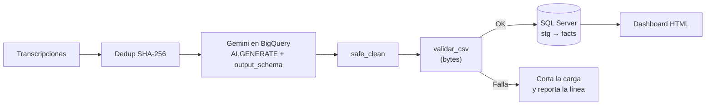

# Pipeline LLM sobre conversaciones grabadas

Extracción de datos estructurados desde transcripciones de un call center con **Gemini en BigQuery**, validación de calidad **a nivel de bytes** y carga a **SQL Server**, con un dashboard HTML para revisar los resultados.


> **Sobre este repo:** es una versión de demostración de un proceso que desarrollé y mantengo en producción. El código original y los datos pertenecen a la empresa, así que acá todo está reescrito y usa **datos sintéticos** (empresa ficticia "Conecta Fibra"). La lógica y las decisiones técnicas son las mismas.

**[Ver el dashboard de demo](https://kevin-villagra-data.github.io/llm-pipeline-conversaciones/)**


---

## Qué resuelve

Las ventas telefónicas quedan grabadas, pero los datos que el cliente dice en la llamada (documento, teléfono, dirección de instalación) no siempre coinciden con los que quedan cargados en la orden de trabajo. Revisarlo a mano no escala.

El pipeline:

1. Toma las transcripciones del día y descarta las repetidas con un **hash SHA-256**.
2. Le pide a **Gemini** (con `AI.GENERATE` dentro de BigQuery) que devuelva los datos en un esquema fijo: documento, teléfono, dirección, resumen y si hubo venta.
3. **Limpia** el texto y **valida el archivo byte por byte** antes de cargar.
4. Carga en SQL Server por lotes y consolida el histórico sin duplicados.
5. Alimenta un **dashboard HTML** que compara lo que dijo el cliente contra la orden de trabajo y marca las discrepancias.



## El problema interesante: bytes que no se ven

En producción, un CSV de 7.203 filas rompía la carga en SQL Server. En el editor se veía perfecto.

El problema estaba en **4 filas**: el modelo había devuelto caracteres de control (`0x03`, `0x04`, `0x13`, `0x14`) en lugar de la `Ñ` y de vocales acentuadas.

```
Lo que se ve:   PEÑA 819
Lo que hay:     50 45 03 41 20 38 31 39   ->  "PE␃A 819"
```

La protección que ya existía (`encode("cp1252", errors="replace")`) no servía, porque **`0x03` es un byte válido en cp1252** y pasa sin cambios. Este test lo deja documentado:

```python
def test_cp1252_con_replace_no_detecta_caracteres_de_control():
    assert "PE\x03A 819".encode("cp1252", errors="replace") == b"PE\x03A 819"
```

La solución fue en dos capas:

- **`safe_clean`** ([limpieza.py](pipeline_llm/limpieza.py)): elimina caracteres de control y normaliza a ASCII. Las filas afectadas quedan marcadas con `requiere_revision`, porque la letra original no se puede recuperar.
- **`validar_csv`** ([validacion.py](pipeline_llm/validacion.py)): lee el archivo final **en bytes**, como lo va a recibir la base, y corta la carga indicando línea y byte si encuentra algo raro o columnas desalineadas.

**La lección:** la salida de un LLM es un dato de origen más y se valida como cualquier otro origen antes de cargar.

## Cómo correrlo

```bash
pip install -r requirements.txt

python main.py                 # flujo completo
python main.py --sin-limpieza  # reproduce el error de producción
pytest                         # 11 tests
```

Salida esperada:

```
[1] 300 conversaciones únicas (5 repetidas descartadas por SHA-256)
[2] Extracción: 300 filas con 5 campos
[3] Limpieza: 4 filas tenían caracteres de control -> marcadas para revisión
[4] Validación OK: 301 líneas sin caracteres de control y con columnas consistentes
[5] Carga: 300 filas en conversaciones_llm (175 con venta concretada)
```

Con `--sin-limpieza`, el validador frena la carga:

```
[4] Validación FALLÓ en 4 línea(s) de 301:
    - línea 59: caracteres de control 0x03
    ...
    La carga se cancela antes de llegar a la base.
```

> Para correr sin cuenta de GCP, `extraccion.py` incluye un extractor local que devuelve la misma estructura que Gemini y simula el bug en 4 filas. La consulta real está en [`sql/bigquery/01_extraccion_gemini.sql`](sql/bigquery/01_extraccion_gemini.sql).

## Estructura

```
├── main.py                         # orquesta el pipeline
├── pipeline_llm/
│   ├── datos_sinteticos.py         # genera transcripciones ficticias
│   ├── extraccion.py               # extractor local (en prod: Gemini)
│   ├── compresion.py               # gzip+base64 y hash SHA-256
│   ├── limpieza.py                 # safe_clean
│   ├── validacion.py               # validar_csv a nivel de bytes
│   └── carga.py                    # CSV cp1252 + carga por lotes
├── sql/
│   ├── bigquery/01_extraccion_gemini.sql
│   └── sqlserver/01_ddl.sql, 02_carga_conversaciones.sql
├── docs/index.html                 # dashboard de demo (GitHub Pages)
└── tests/test_pipeline.py
```

## Decisiones técnicas

| Decisión | Por qué |
|---|---|
| `AI.GENERATE` con `output_schema` | El modelo devuelve columnas tipadas en lugar de texto libre, sin parsear JSON a mano. |
| Carga incremental en BigQuery | Solo se procesan conversaciones nuevas del día, así no se paga dos veces por la misma llamada al modelo. |
| Hash SHA-256 del texto normalizado | Detecta la misma conversación aunque cambien espacios o mayúsculas. Es la clave del histórico. |
| Transcripción comprimida (gzip+base64) | El dashboard es un único HTML: la conversación viaja comprimida y se descomprime en el navegador. |
| Validar el archivo y no el DataFrame | El error solo existía en los bytes. Validar lo que realmente llega a la base es lo que lo detecta. |
| Staging + `INSERT ... WHERE NOT EXISTS` | Reprocesar un día no duplica filas en el histórico. |

## Próximos pasos

- Orquestar con **Airflow** en lugar de un job programado.
- Pasar las validaciones a tests de **dbt** sobre la tabla de staging.
- Medir la tasa de `requiere_revision` por día como métrica de calidad del modelo.

---

Kevin Villagra · [LinkedIn](https://www.linkedin.com/in/kevin-villagra-data/)
